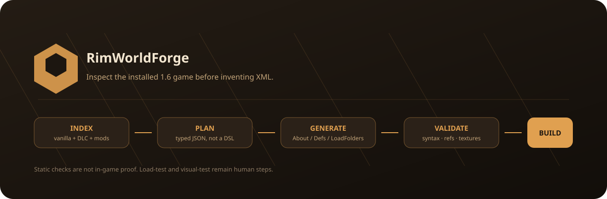

<p align="center">
  
</p>

<div align="center">

# RimWorldForge 0.4.0

**Inspect the installed RimWorld 1.6/1.7 game before inventing XML.**

A local-first AI modding workbench: deterministic Python tools plus a compact
skill that teaches agents how to build real mods without loading a giant MCP
schema every turn.

<p>
  <a href="https://github.com/SenjuWoo/RimWorldForge/actions/workflows/ci.yml"></a>
  <a href="LICENSE"></a>
  <a href="https://github.com/SenjuWoo/RimWorldForge/releases/latest"></a>
  
  
</p>

<p>
  <a href="#install">Install</a>
  ·
  <a href="#the-forge-loop">Loop</a>
  ·
  <a href="#what-works-now">Status</a>
  ·
  <a href="CHANGELOG.md">Changelog</a>
</p>

</div>

<p align="center">
  
</p>

A local-first AI modding workbench for **RimWorld 1.6 and 1.7**, with free procedural art generation. It is designed for agents that should create actual mods, inspect the game before inventing XML, validate what they wrote, package clean outputs, and report exactly what has and has not been proven.

RimWorldForge is deliberately split into two layers:

1. **Forge core**: deterministic Python tools for discovery, Def indexing, generation, validation, C# scaffolding, packaging, and log analysis.
2. **Agent intelligence**: a compact skill and docs that teach an AI how to choose vanilla XML, Biotech genes/xenotypes, HAR races, Harmony/C#, and art workflows without loading a giant MCP schema every turn.

The foundation targets RimWorld **1.6 and 1.7** and knows the current expansion layout through **Odyssey**. It never treats static XML parsing as proof that a mod works in-game.

| | 1.6 | 1.7 |
|---|---|---|
| Runtime | .NET Framework 4.7.2 | .NET 10 (Waylith engine) |
| Harmony | 2.4.3 | 3.x |
| Logs | `LocalLow/.../Player.log` | `LocalLow/.../Logs/Player.log` + `harmony.log.txt` |
| C# references | `Assembly-CSharp`, `UnityEngine`, `UnityEngine.CoreModule` | `Assembly-CSharp`, `UnityStubs`, `Waylith` |

1.7 is still an unstable Steam branch as of October 2026; the 1.6 path remains the default for new projects.

## What works now

| Capability | State |
|---|---|
| Detect RimWorld + installed DLC | implemented |
| Index Core/Royalty/Ideology/Biotech/Anomaly/Odyssey Defs | implemented |
| Index installed mods incl. versioned layouts (`1.6/`, `1.7/`, `Common/`, `LoadFolders.xml` with `IfModActive`/`IfModActiveAll`) | implemented |
| Search vanilla/DLC/installed-mod Defs by concept, label, type, or defName | implemented |
| Clone an installed Def into an editable typed blueprint plan | implemented |
| Scan local/Workshop mods and detect key frameworks (HAR, Harmony, VEF, VFEC, Big & Small, Giddy-Up, RJW, RimTalk, HugsLib, Vehicle Framework) | implemented |
| Emit production image prompts from asset manifests | implemented |
| Inspect source XML for an indexed Def | implemented |
| Create isolated mod workspaces | implemented |
| Generate `About.xml`, Def XML and `LoadFolders.xml` from typed JSON plans | implemented |
| Generic nested XML fields, lists and XML attributes | implemented |
| Static About/Def/Patch validation | implemented |
| Duplicate defName and texture-path checks | implemented |
| Conservative reference checks against a real game index (vanilla + installed mods) | implemented |
| Clean build folder, ZIP, SHA-256 file manifest and receipt | implemented |
| Analyze `Player.log` plus 1.7's `harmony.log.txt`: duplicate-exception storms, Harmony wrapper de-mangling, failure phases, optional PII redaction | implemented |
| C# project scaffold against the installed game: 1.6 `net472` or 1.7 `net10.0` with `Waylith`/`UnityStubs` | implemented |
| C# compile through `dotnet build` | implemented, explicit approval required |
| Stage a built mod into `RimWorld/Mods` with SHA-256 ownership manifest, backup and rollback | implemented, explicit approval required |
| Autonomous game launch / spawn test | not implemented yet |
| Visual correctness test | human or vision step |
| Free local procedural art | buildings, items, apparel, directional pawns, icons and previews; deterministic Pillow generator, no network or paid API |
| One-command demo / golden path | implemented, pipeline proof only |
| Steam Workshop publication | not implemented yet |

Run `rwforge capabilities` for the machine-readable matrix.

## The Forge loop

```text
idea
  |
  v
search real vanilla/DLC examples
  |
  v
write a typed plan
  |
  v
plan-validate -> generate -> validate
  |                         |
  |                         +-- syntax / duplicate / texture / reference checks
  v
optional C# scaffold + compile
  |
  v
build -> clean folder + zip + SHA-256 receipt
  |
  v
stage manually-approved copy into RimWorld/Mods
  |
  v
launch RimWorld yourself -> Player.log
  |
  v
log-analyze -> repair -> repeat
```

## Golden path

One command creates a small demo mod, draws its textures and preview locally, validates it, and builds a ZIP:

```text
rwforge demo --output Workspaces/Demo
```

It is a pipeline proof, not a balance-tested or load-tested mod. Open the PNGs and load the result in RimWorld before calling it working.

The first design rule is **inspect before inventing**. RimWorld's Defs map directly onto C# `Def` classes and vanilla Defs are the best practical schema examples. A weak model becomes dramatically more reliable when it can search the installed game instead of guessing tag names from memory.

## Install

Requirements: Windows 10/11, macOS, or Linux; Python 3.10+; Pillow is installed with the package; RimWorld 1.6 or 1.7 for game-aware operations.

### One click (Windows)

Double-click:

```text
START-HERE.bat
```

or run:

```powershell
.\Install.ps1
```

The installer creates `.venv`, installs RimWorldForge, runs its self-tests, and then wires
up every agent CLI it finds on the machine:

| Agent | What it does |
|---|---|
| **Hermes** | Creates a dedicated `rimworld` profile (`hermes -p rimworld` / `rimworld` wrapper) with the rimworldforge MCP server enabled **only in that profile** and the skill installed — zero token cost in other profiles. The installer also mirrors the MCP servers already enabled in your **default** Hermes profile into it, so the RimWorld profile keeps your usual tools (github, context7, …) alongside the forge |
| **Claude Code** | Registers the MCP at user scope (`claude mcp add --scope user`) and installs the skill |
| **Codex CLI** | Copies the skill to `~/.codex/skills` (Codex has no project-scoped MCP config; point it at the server command manually if wanted) |

Nothing is registered globally that wasn't already there, no RimWorld files, mod lists or
saves are touched, and `Uninstall.ps1` reverses all of it.

### Manual

```bash
python -m venv .venv
.venv/Scripts/python -m pip install -e .      # Windows
# .venv/bin/python -m pip install -e .        # Linux/macOS

rwforge doctor
rwforge capabilities
```

If automatic discovery misses your install:

```powershell
$env:RIMWORLD_ROOT = 'D:\SteamLibrary\steamapps\common\RimWorld'
rwforge doctor
```

### Environment variables (all optional)

| Variable | Purpose |
|---|---|
| `RIMWORLD_ROOT` | RimWorld install root, if registry/Steam discovery fails |
| `RIMWORLD_WORKSHOP_ROOT` | Extra Steam Workshop content root(s) to scan for mods (`os.pathsep`-separated for several). Each may be either the `steamapps/workshop/content/294100` folder itself or its parent `steamapps/workshop` folder |
| `RIMWORLD_MODS_ROOT` | Additional mods directory beyond the game's own `Mods` folder |
| `RIMWORLD_FORGE_HOME` | Where the index is stored (defaults to the platform data directory) |

`rwforge index` auto-discovers mods from the game's `Mods` folder plus **every Steam
library's** Workshop content root found via `libraryfolders.vdf` — multi-drive Steam
setups need no configuration. Pass `--mods-root` explicitly to replace auto-discovery.

## First real workflow

### 1. Index the installed game

```text
rwforge index
rwforge search mechanoid --type ThingDef
rwforge inspect Centipede
rwforge def-blueprint Centipede MyHeavyMech --output plans/my-heavy-mech.json --package-id author.mymech --mod-name "My Heavy Mech"
rwforge mods-scan
```

The index is written under `%LOCALAPPDATA%\RimWorldForge\indexes` on Windows or the platform data directory elsewhere.

### 2. Create a workspace

```text
rwforge project-new "Warden Mech" --package-id yourname.wardenmech --workspace Workspaces/WardenMech
```

The live game is not touched. The workspace contains:

```text
WardenMech/
  forge.json
  plans/
  reports/
  csharp/
  source/
    About/About.xml
    Defs/
    Patches/
    Textures/
    Assemblies/
    Languages/English/
  build/
```

### 3. Start from the bundled example

```text
copy examples\warden-mech.plan.json Workspaces\WardenMech\plans\warden.plan.json
rwforge plan-validate Workspaces\WardenMech\plans\warden.plan.json
rwforge generate Workspaces\WardenMech Workspaces\WardenMech\plans\warden.plan.json
rwforge validate Workspaces\WardenMech
rwforge build Workspaces\WardenMech
```

The example is intentionally a **teaching plan**, not a claim that one generic XML block is a complete balanced Biotech mech. Before shipping it, inspect current installed 1.6/1.7 mech Defs and adapt fields to the exact parent/classes your game exposes.

### 4. Test and diagnose

After you manually enable the staged/built mod in RimWorld and launch the game:

```text
rwforge log-analyze
```

It groups common failures including unresolved cross-references, XML errors, missing assemblies, Harmony failures, texture errors and exceptions.

## Typed plan format

The plan deliberately mirrors RimWorld XML rather than hiding it behind a huge opinionated DSL.

```json
{
  "schema": 1,
  "mod": {
    "name": "Example Mod",
    "packageId": "author.example",
    "author": "Author",
    "supportedVersions": ["1.6"],
    "description": "Example generated mod"
  },
  "defs": [
    {
      "type": "ThingDef",
      "attributes": {"ParentName": "BaseThing"},
      "fields": {
        "defName": "Author_ExampleThing",
        "label": "example thing",
        "description": "A generated example.",
        "statBases": {
          "MaxHitPoints": 250,
          "MarketValue": 100
        }
      }
    }
  ],
  "assets": []
}
```

Nested objects become nested XML nodes. Lists become `<li>` lists. Prefix dictionary keys with `@` when an XML child needs attributes, or use an explicit `_tag` for a non-`li` list item. This keeps the plan expressive enough for normal RimWorld Defs without teaching Forge every future `Def` subclass.

See `schemas/project-plan.schema.json`, `docs/MODDING-GUIDE.md`, and `docs/CONTENT-RECIPES.md`.

## Races and NPCs

RimWorldForge's intended routing is:

- **Vanilla humanlike content**: `PawnKindDef`, factions, backstories, apparel, traits, etc.
- **Biotech**: `GeneDef` + `XenotypeDef` when the concept can be expressed through genes.
- **Humanoid Alien Races**: XML-driven custom race bodies/graphics/restrictions when HAR is the right dependency.
- **C# / Harmony**: only when the behavior cannot be represented cleanly with Defs or an established framework.

HAR currently declares RimWorld 1.6 support and remains a natural route for full custom humanoid races. RimWorldForge does not vendor HAR or Harmony.

## Art pipeline

RimWorld mod art is not "generate one pretty picture and call it done." Pawn, apparel, weapon, building, UI and preview assets each have different framing and directional requirements.

Plans can declare assets:

```json
{
  "id": "warden_body",
  "kind": "pawn_directional",
  "target": "Textures/Shugoki/Warden/Warden_south.png",
  "transparent": true,
  "style": "RimWorld-compatible top-down pawn sprite",
  "directions": ["south", "north", "east"],
  "notes": "west may be mirrored only if the design is symmetric"
}
```

`ASSETS-NEEDED.json` is generated into the workspace. `rwforge art-prompts <workspace>` turns every asset brief into a production prompt file for an external image generator.

Forge also ships a **free, local procedural generator** for a usable starting asset:

```text
rwforge assets-generate Workspaces/MyMod
rwforge assets-generate Workspaces/MyMod --force --seed my-mod-v1
```

It reads the same manifest and draws buildings, weapons, apparel, items, icons, directional pawns and 640x360 previews with Pillow. It is deterministic per seed, needs no network, and writes `reports/assets-generated.json` with SHA-256 hashes. Generated art is a starting point: inspect the PNGs at 1:1 and in game before calling it visually tested.

The bundled `examples/art/warden-concept.svg` is **concept/reference art only**, not a game-ready pawn texture. `docs/ART-PIPELINE.md` explains the contract.

<p align="center">
  
</p>

<p align="center"><sub>Concept / reference only. Not a game-ready directional pawn texture.</sub></p>

## C# escalation

```text
rwforge csharp-scaffold Workspaces/MyMod
rwforge csharp-build Workspaces/MyMod --approve
```

The scaffold targets the detected game version, or an explicit `--version 1.6|1.7`. A 1.6 project references the Unity assemblies and targets `net472`; a 1.7 project references `Assembly-CSharp`, `UnityStubs` and `Waylith` and targets `net10.0`. Compiling both from one machine would need both reference sets installed, so Forge does not pretend to cross-compile. External compilation is approval-gated because it launches a compiler. Harmony is optional and must be supplied explicitly with `--harmony-dll` if a project needs it.

## MCP

The MCP façade intentionally stays at 12 broad tools. Expert helpers such as Def blueprints, mod/framework scans, C# compilation, the demo and art-prompt emission remain CLI/skill operations so they do not inflate every MCP turn:

```text
rw_doctor
rw_capabilities
rw_index
rw_def_search
rw_def_inspect
rw_project_new
rw_plan_validate
rw_generate
rw_validate
rw_build
rw_log_analyze
rw_assets_generate
```

Start it with:

```text
.venv\Scripts\python.exe mcp_server\server.py
```

It uses a tiny stdio JSON-RPC implementation and no external MCP SDK. Keep it disabled outside RimWorld work to preserve prompt context. The companion skill carries the workflow intelligence so the MCP does not need dozens of micro-tools.

## Evidence tiers

RimWorldForge never collapses these into one fake green check:

1. `syntax_valid`: Forge could parse and structurally inspect the files.
2. `references_valid`: conservative references were checked against a real installed-game index.
3. `compiled`: C# compiler accepted the project and a DLL was produced.
4. `load_tested`: RimWorld loaded the mod without relevant startup errors. Not automated yet.
5. `runtime_tested`: spawned/used content actually behaved correctly. Not automated yet.
6. `visual_tested`: textures, draw sizes, offsets, directional art and UI look correct.

A build receipt records the evidence that actually exists.

## Current source of truth

The foundation was grounded against current references in October 2026:

- RimWorld Wiki: Mod Folder Structure, About.xml, XML Defs, XML file structure
- RimWorld Wiki: RimWorld 1.7 Mod Updates (net10.0, Harmony 3, new `Logs/` folder)
- Ludeon Studios: RimWorld 1.6 and the Waylith/1.7 announcement
- Ludeon: Modder Primer for 1.7 (`Assembly-CSharp`, `UnityStubs`, `Waylith`, `RimWorld` host)
- Humanoid Alien Races repository: current support declaration and XML-focused feature set

See `knowledge/SOURCES.md` for the URLs and what each source is allowed to prove.

## Roadmap to 1.0

The next high-value work is deliberately runtime-heavy rather than adding 80 more generator templates:

- controlled temporary ModsConfig generation
- launch-and-watch test profile
- parse only errors attributable to the generated packageId
- developer-mode spawn/instantiate test harness
- screenshot capture + vision inspection for art offsets and clipping
- stronger reflection-backed C# field/schema extraction
- HAR helper plans and Biotech xenotype helpers built from installed examples
- Steam Workshop packaging/publishing as a separate trust gate
- benchmark: weak local model, same mod prompt, baseline vs Forge

The foundation is useful now, but 1.0 should mean **proved behavioral improvement and a full automated load-test loop**, not a larger README.

## License

[MIT](LICENSE)

RimWorld is a trademark of Ludeon Studios. This project is unofficial.
