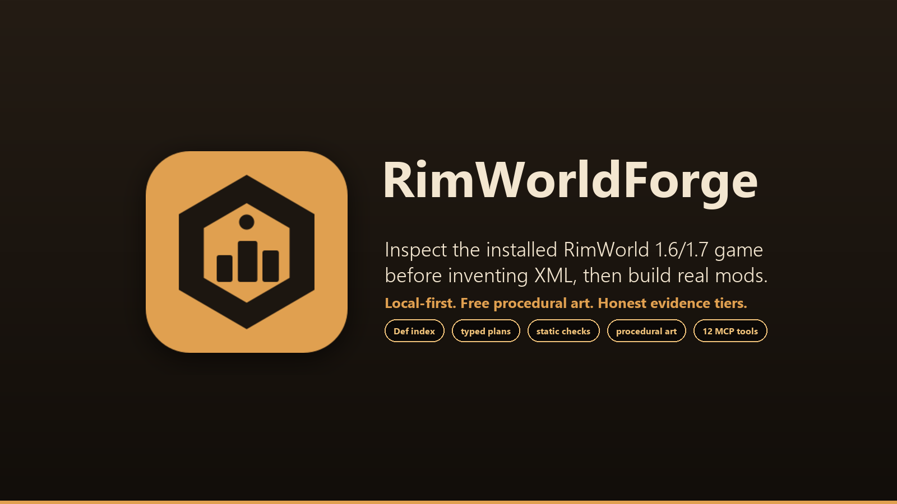
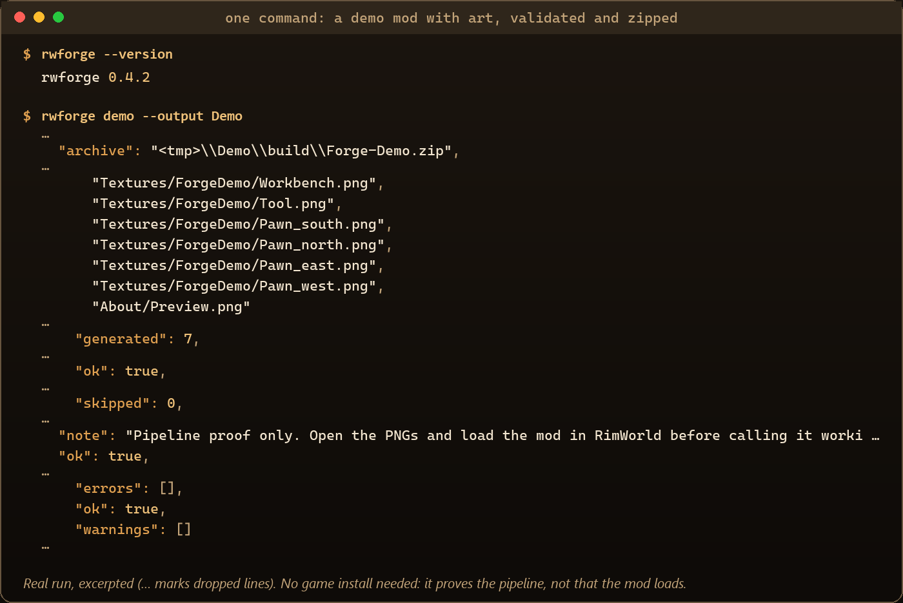
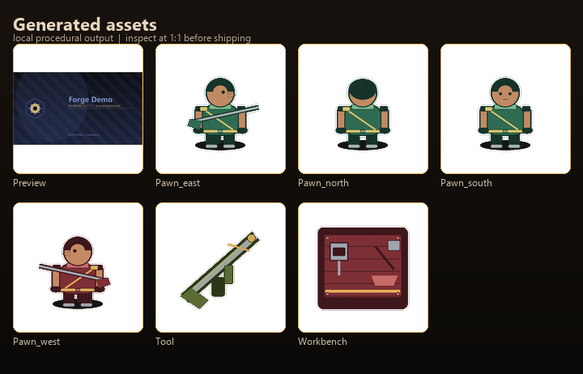
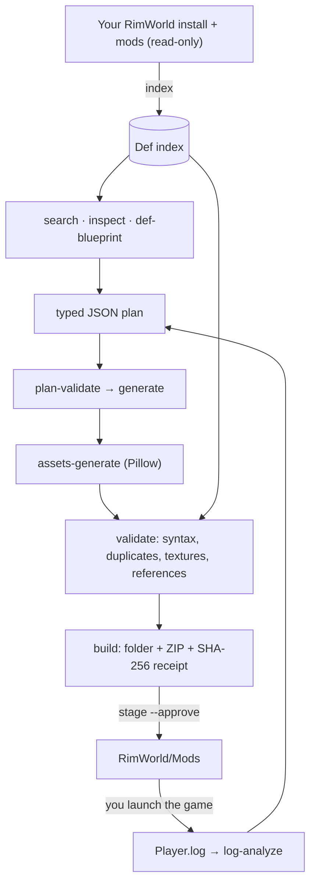

<div align="center">



[](https://github.com/SenjuWoo/RimWorldForge/actions/workflows/ci.yml)
[](https://github.com/SenjuWoo/RimWorldForge/releases/latest)
[](docs/REFERENCE.md#design)
[](pyproject.toml)
[](LICENSE)

**[Install](#install)** · **[Tour](#a-two-minute-tour)** · **[Commands](#commands)** · **[How it works](#how-it-works)** · **[Reference](docs/REFERENCE.md)** · **[Changelog](CHANGELOG.md)**

</div>

RimWorldForge is a local-first AI modding workbench for **RimWorld 1.6 and 1.7**,
with free procedural art generation. It is built for agents that should create
actual mods: inspect the installed game before inventing XML, validate what they
wrote, package clean outputs, and report exactly what has and has not been
proven. Deterministic Python tools do the work; a compact skill teaches the
agent the workflow, so no giant MCP schema has to ride along every turn.

## What you get

- **The game as the schema.** `index` reads Core and every installed DLC through Odyssey, plus your installed and Workshop mods (versioned `1.6/`, `1.7/`, `Common/` and `LoadFolders.xml` layouts included). `search`, `inspect` and `def-blueprint` let an agent copy a real Def instead of guessing tag names.
- **Plans that mirror XML.** A typed JSON plan becomes `About.xml`, Def XML and `LoadFolders.xml`. Nested objects become nodes, lists become `<li>`, `@` keys carry attributes.
- **Checks before the game starts.** Static About/Def/Patch validation, duplicate defNames, texture paths, and conservative cross-references against your real game index.
- **Free art to start from.** `assets-generate` draws buildings, weapons, apparel, items, icons, directional pawns and 640x360 previews with Pillow: deterministic per seed, no network, no paid API.
- **Clean builds with receipts.** A build folder, a ZIP, a SHA-256 file manifest and a receipt that records which evidence actually exists.
- **Approval-gated steps.** C# compile (`dotnet build`) and staging into `RimWorld/Mods` (with ownership manifest, backup and rollback) only run with `--approve`.
- **Log diagnosis.** `log-analyze` groups `Player.log` (and 1.7's `harmony.log.txt`) failures: duplicate-exception storms, de-mangled Harmony wrappers, failure phases, optional redaction.



## Install

**Windows:** clone or download the [latest release](https://github.com/SenjuWoo/RimWorldForge/releases/latest) and double-click `START-HERE.bat` (or run `.\Install.ps1`). It creates `.venv`, installs the package, runs the self-tests, puts an `rwforge` launcher on your user PATH, and adds the MCP server and skill to Hermes (its own `rimworld` profile), Claude Code and Codex when it finds them. Integration is additive and never touches RimWorld files, mod lists or saves. `-DryRun` shows what it would do; `-NoAgentIntegration` installs standalone.

**Any OS with Python 3.10+:**

```bash
python -m venv .venv
.venv/Scripts/python -m pip install -e .      # Windows
# .venv/bin/python -m pip install -e .        # Linux/macOS

rwforge doctor
rwforge capabilities
```

If discovery misses your game, set `RIMWORLD_ROOT`. Every switch, environment variable and what `Uninstall.ps1` removes: [docs/INSTALL.md](docs/INSTALL.md).

## A two-minute tour

```text
rwforge demo --output Workspaces/Demo                  # golden path: plan, art, validate, zip
rwforge index                                          # once per game/mod update
rwforge search mechanoid --type ThingDef               # real examples before writing XML
rwforge inspect Centipede
rwforge def-blueprint Centipede MyHeavyMech --output plans/my-heavy-mech.json --package-id author.mymech --mod-name "My Heavy Mech"
rwforge project-new "Warden Mech" --package-id yourname.wardenmech --workspace Workspaces/WardenMech
rwforge plan-validate Workspaces/WardenMech/plans/warden.plan.json
rwforge generate Workspaces/WardenMech Workspaces/WardenMech/plans/warden.plan.json
rwforge assets-generate Workspaces/WardenMech
rwforge validate Workspaces/WardenMech
rwforge build Workspaces/WardenMech
rwforge log-analyze                                    # after you launch RimWorld yourself
```

`demo` creates a small demo mod, draws its textures and preview locally, validates it, and builds a ZIP in one command. It is a pipeline proof, not a balance-tested or load-tested mod. Open the PNGs and load the result in RimWorld before calling it working. The bundled `examples/warden-mech.plan.json` is a **teaching plan**: inspect your installed mech Defs and adapt it before shipping.


The procedural generator's output, combined by `assets-sheet` into one review image:

<p align="center">
  
</p>

## Commands

| Need | Command |
|---|---|
| Health check, machine-readable capability matrix | `rwforge doctor` · `rwforge capabilities` |
| Index the game, DLC and installed/Workshop mods | `rwforge index [--mods-root DIR]` |
| Find and read real Defs | `rwforge search <term> [--type ThingDef]` · `inspect <defName>` |
| Clone a Def into an editable plan | `rwforge def-blueprint <def> <newDef> --output plan.json` |
| Which frameworks are installed (HAR, Harmony, VEF, RJW, HugsLib, ...) | `rwforge mods-scan` |
| New isolated workspace | `rwforge project-new <name> --package-id <id> [--rimworld-version 1.6\|1.7]` |
| Plan to XML, then check | `rwforge plan-validate <plan>` · `generate <ws> <plan>` · `validate <ws>` |
| Art | `rwforge assets-generate <ws> [--seed S]` · `assets-sheet <ws>` · `art-prompts <ws>` |
| Package | `rwforge build <ws>` |
| C# against the installed game | `rwforge csharp-scaffold <ws> [--version 1.6\|1.7]` · `csharp-build <ws> --approve` |
| Test install into `RimWorld/Mods` | `rwforge stage <ws> --approve` · `stage-rollback <ws>` |
| Diagnose a run | `rwforge log-analyze [log] [--redact]` |
| One-command pipeline proof | `rwforge demo --output <dir>` |

The MCP server (`mcp_server/server.py`, stdio, no SDK) exposes 12 broad tools; expert helpers stay CLI/skill operations so they cost no context per turn. Full capability matrix, plan format, content routing (vanilla, Biotech, HAR, C#/Harmony), art pipeline and MCP list: [docs/REFERENCE.md](docs/REFERENCE.md).

## How it works



Evidence stays in separate tiers and is never collapsed into one green check:
`syntax_valid`, `references_valid`, `compiled`, `load_tested`, `runtime_tested`,
`visual_tested`. Load and runtime testing are not automated yet, so the forge
reports them as false until you test in game. See [docs/VALIDATION.md](docs/VALIDATION.md).

More: [ARCHITECTURE](docs/ARCHITECTURE.md) · [AGENT-WORKFLOW](docs/AGENT-WORKFLOW.md) · [MODDING-GUIDE](docs/MODDING-GUIDE.md) · [CONTENT-RECIPES](docs/CONTENT-RECIPES.md) · [ART-PIPELINE](docs/ART-PIPELINE.md) · [EXTENDING](docs/EXTENDING.md) · [RUNTIME-HARNESS-DESIGN](docs/RUNTIME-HARNESS-DESIGN.md).

## Tested

```bash
python tests/run_tests.py
```

34 offline tests run on every push: indexing (versioned mod layouts, `LoadFolders.xml` conditions, Workshop discovery), plan generation, validation, builds, log analysis and redaction, C# scaffolds for both versions, staging with backup and rollback, procedural art and the demo. They use synthetic game trees. The screenshots above are real runs of the installed CLI; no RimWorld install was available for them, so `index`, `search` and `inspect` against a live game are not pictured.

## Roadmap

1.0 should mean proved behavioral improvement and a full automated load-test loop:
temporary ModsConfig profiles, launch-and-watch, a developer-mode spawn harness,
screenshot plus vision checks for art, and Workshop publishing as its own trust
gate. The full list is in [docs/REFERENCE.md](docs/REFERENCE.md#roadmap-to-10).

## License

[MIT](LICENSE). RimWorld is a trademark of Ludeon Studios. This project is unofficial.
